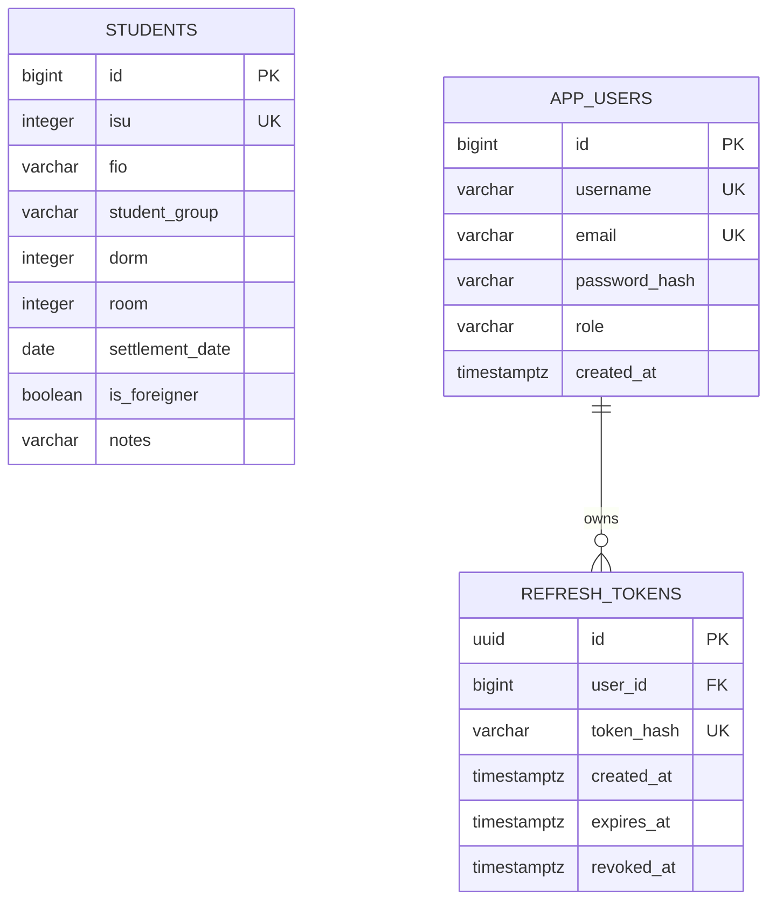

# Архитектура и схема данных — шаги 1–10

## Зависимости слоёв

```text
HTTP-контроллер -> сервис -> репозиторий -> EclipseLink/JPA -> PostgreSQL
        |            |
       DTO <------ маппер <------ сущности
```

Базовый пакет — `ru.itmo.students`.

| Пакет | Ответственность | Что есть сейчас |
|---|---|---|
| controller | HTTP, параметры, статусы, делегирование сервису | StudentApi, StudentController, AuthController |
| service | Бизнес-правила, транзакции, PATCH, конфликты и пользователи | StudentService, JpaStudentService, AuthService |
| repository | Запросы к данным | Три рабочих Spring Data JPA-репозитория |
| entity | Отображение таблиц, внутренняя идентичность | StudentEntity, UserEntity, RefreshTokenEntity, Role |
| dto | Входные/выходные данные API, без JPA-аннотаций | Запись, полное и частичное изменение, запрос списка, страница, ошибка |
| mapper | Преобразование сущности студента в DTO и обратно | StudentMapper |
| validation | Нормализация, типы, правила полей и связанных данных | StudentInputParser, StudentValidator, StudentSort, правила регистрации |
| exception | Единые JSON-ошибки HTTP, модели и БД | ApiException, ApiExceptionHandler |
| web | Метод QUERY и фильтры вне MVC | QueryMapping, ApiErrorWriter, RateLimitFilter, IpRateLimiter |
| security | Выпуск JWT и построение пользователя с актуальной ролью | JwtTokens, DatabaseJwtAuthenticationConverter |
| config | Spring, EclipseLink, транзакции, HTTP, JWT, CORS и bootstrap | Конфигурационные классы и параметры окружения |

Контроллеры не обращаются к репозиториям. Сервисы не зависят от servlet API,
ResponseEntity и HttpServletRequest. Сущности не возвращаются из REST API:
в них есть внутренние id, связи и хеши, которых не должно быть в ответах.
StudentApi и StudentService реализованы отдельными классами. Все студенческие
операции используют PostgreSQL через EclipseLink. Запрос списка строится через
JPA Specification: поиск и фильтры, подсчёт, сортировка и выбор страницы выполняются
в БД. LIKE-символы %, _ и обратная косая черта в поиске экранируются как литералы.
Поля сортировки проверяются по белому списку, при равенстве используется id ASC.

AuthService реализует регистрацию, вход, обновление и выход. JwtTokens выпускает
подписанные access/refresh JWT через NimbusJwtEncoder; отдельные decoder проверяют
назначение токенов. Регистрационный DTO включает предел BCrypt в байтах UTF-8.

## PostgreSQL



### Студенты

`id` — внутренний автоматически назначаемый первичный ключ. `isu` — уникальный
публичный идентификатор. Разделение позволяет менять ИСУ, сохраняя идентичность
строки. Во внешнем API `group` и `date` сохраняют имена; в SQL используются
`student_group` и `settlement_date`.

В БД закреплены диапазоны ИСУ/номеров, длины строк, формат группы, минимальная
дата и совместное заполнение полей заселения. Регулярное выражение для ФИО,
нормализация, входные типы и сообщения ошибок реализованы серверной валидацией.
SQL-ограничения дополнительно защищают целостность при конкурирующих запросах.
Индексы подготовлены для группы, общежития/комнаты и ФИО.

### Пользователи

Имя и email уникальны без учёта регистра через индексы `lower(...)`.
Миграция V3 задаёт Unicode-коллацию этим столбцам, чтобы индексы одинаково
обрабатывали регистр, включая нелатинские символы email, при любой локали ОС.
Репозиторий использует соответствующие методы IgnoreCase. Роль хранится строкой
ADMIN/USER с CHECK-ограничением. Поля для открытого пароля нет; password_hash
получает BCrypt-хеш в AuthService. Регистрация всегда создаёт USER. Первый ADMIN
может создаваться отдельным необязательным bootstrap при запуске; публичного
назначения роли нет. Внешний UserResponse не содержит пароль или хеш.

### Refresh-токены

Несколько токенов могут принадлежать одному пользователю, например для разных
сеансов. Таблица хранит уникальный SHA-256-хеш токена, даты создания, истечения и
отзыва. UUID строки не является самим токеном. Срок истечения должен быть позже
создания. Удаление пользователя каскадно удаляет его refresh-токены в БД.
Выпуск, проверка и ротация токенов реализованы. Обновление блокирует строку
refresh-токена, проверяет назначение, владельца, хеш, срок и отсутствие отзыва,
затем атомарно отзывает старую запись и создаёт новую. Выход отзывает refresh;
выданный access действует до своего истечения. См. authentication.md.
InstantConverter явно преобразует Java Instant в JDBC Timestamp и обратно:
в JPA 3.1 Instant ещё не стандартизован как временной базовый тип. В PostgreSQL
эти значения хранятся в TIMESTAMP WITH TIME ZONE с сохранением момента времени.

Связь в JPA односторонняя от токена к пользователю. Загрузка EAGER выбрана явно:
сейчас weaving выключен, поэтому не требуется javaagent и дополнительная
настройка Eclipse/командной строки. Общий кеш EclipseLink выключен, чтобы не
получать устаревшие записи при нескольких процессах приложения.

## Миграции и транзакции

Flyway выполняет V1 (таблицы), V2 (Unicode-коллация ФИО/заметок) и V3 (Unicode
для уникальности пользователей) до создания EntityManagerFactory.
V2/V3 используют встроенную pg_c_utf8 из PostgreSQL 17+:
регистронезависимый поиск на русском не зависит от локали initdb/операционной системы.
EclipseLink не создаёт и не изменяет таблицы самостоятельно. Следующие изменения
схемы добавляются отдельными V4, V5 и т. д.; применённые миграции не редактируют.
Автоматическая очистка Flyway отключена.

JpaTransactionManager подключён. JpaStudentService выполняет чтение в readOnly
транзакциях, а изменения — в отдельных транзакциях с flush до возврата результата.
При PUT, PATCH и DELETE строка блокируется PESSIMISTIC_WRITE, чтобы параллельные
изменения не затирали друг друга. PATCH объединяет только переданные разрешённые
поля с текущей записью и проверяет результат до изменения сущности. PUT сбрасывает
непереданные необязательные поля. HTTP-запрос не держит EntityManager открытым.

Исходный `../students.json` не изменён. Первоначальный запуск через start.cmd
подготавливает локальную копию с согласованным исправлением ФИО ИСУ 100097 и
включает внутренний StudentImportService через ApplicationRunner. Весь файл
валидируется до вставок; вставки выполняются в транзакции, существующие ИСУ
сохраняются. После успешного импорта launcher создаёт локальный маркер, и обычные
старты уже не повторяют импорт. Перенесены 122 записи.

Readiness `/actuator/health/readiness` включает завершение ApplicationRunner,
поэтому скрипт ожидает готовности миграций, bootstrap и импорта перед открытием UI.

## HTTP, ошибки и безопасность

StudentController обслуживает GET, POST, PUT, PATCH, DELETE, HEAD и OPTIONS.
Для QUERY используется составная аннотация QueryMapping и пользовательское
RequestCondition в WebConfiguration: стандартный RequestMethod Spring 6 не
содержит QUERY. Метод также разрешён в StrictHttpFirewall. Запросы другими
методами на известный маршрут получают 405 с Allow.

ApiExceptionHandler централизует ошибки MVC, модели, SQL-ограничений и непредвиденные
исключения. Клиент получает ApiError, внутренние подробности остаются в логе.
Проверка уникальности выполняется сервисом и дублируется ограничениями БД;
если конфликт возник между проверкой и записью, SQLState 23505 также превращается
в 409. Security и rate limit находятся вне MVC и используют тот же ApiErrorWriter.

SecurityFilterChain аутентифицирует access JWT через Spring OAuth2 Resource Server,
а DatabaseJwtAuthenticationConverter загружает пользователя и актуальную роль.
Маршруты и @PreAuthorize на сервисе независимо ограничивают операции USER/ADMIN.
Анонимные запросы к данным дают 401, недостаточная роль — 403. StudentHttpIT теперь
выполняет настоящий login и передаёт JWT: разрешающей тестовой цепочки больше нет.
CorsFilter установлен в Security перед JWT и не регистрируется второй раз как
отдельный servlet-фильтр. Отказы CORS также возвращают ApiError.

RateLimitFilter стоит после Security и допускает 100 API-запросов за 60 секунд
с одного IP. OPTIONS не учитывается, X-Forwarded-For не доверяется. Используется
скользящее окно с монотонными часами, синхронизацией и очисткой устаревших IP.
Состояние находится в памяти одного процесса.
Публичные методы авторизации проходят Security и учитываются счётчиком, даже
если неверные данные затем дают 401 в AuthService. OPTIONS пропускается.

## Клиент

Статический клиент сохраняет существующие страницы и оформление. login.html/login.js
добавляют вход и регистрацию, config.js задаёт Java API, auth.js управляет
sessionStorage и общим обновлением токенов для параллельных запросов вкладки.
api.js и QUERY в main.js используют Auth.fetch. Данные об актуальной роли
загружаются через /auth/me; только затем показывается содержимое защищённой страницы.
USER видит список/досье, ADMIN также форму и действия изменения. Проверки интерфейса
дополняют серверные ограничения, не заменяя их. Сортировка подключена к серверу.

## Документирование API

OpenApiConfiguration загружает точный контракт из resources/openapi/students-api.yaml.
Springdoc публикует `/v3/api-docs`, `/v3/api-docs.yaml` и Swagger UI. Два контроллера
помечены @Hidden только для автоматического сканирования документации: HTTP-маршруты
остаются прежними. Это позволяет явно описать JsonNode/PATCH и не превращать
специальное условие QUERY в фиктивные стандартные операции.

QUERY описан vendor-расширением x-query и демонстрируется запросом коллекции
Postman. Неиспользуемые с точки зрения стандартных операций схемы не удаляются
(`remove-broken-reference-definitions=false`), поскольку на StudentQueryRequest
ссылается именно расширение. ApiDocumentationIT проверяет все локальные $ref.
GET к документации разрешён без JWT; правила доступа к студентам не меняются.

docs/postman содержит переносимую коллекцию v2.1 с проверками и пустой пример
окружения. Newman — только devDependency для автоматической проверки коллекции;
для запуска статического frontend сборка и Newman не нужны.

## Локальный запуск

start.cmd/stop.cmd/status.cmd вызывают scripts/project.py на установленном Python.
Launcher читает server/.env как данные без выполнения команд, выбирает JDK 17+,
управляет только Compose-проектом itmo-lr3, собирает JAR и запускает Java/статический
сервер скрытыми процессами. PID и время создания записываются в .runtime;
повторный старт не дублирует процессы, stop проверяет их принадлежность.
Блокировка launcher.lock исключает одновременный запуск двух стартовых команд.

scripts/static_server.py обслуживает только разрешённые публичные файлы и
динамический config.js с текущим портом API. .env, .runtime, JSON исходных данных
и серверный код по HTTP недоступны. Сервисы привязаны к локальному интерфейсу;
PostgreSQL сохраняет данные в отдельном именованном Docker volume.

## Принятые версии

- Java 17 — базовый уровень компиляции.
- Spring Boot 3.5.16 / Spring Framework 6.2 — линия с Jakarta Persistence 3.1.
- EclipseLink 4.0.9 — провайдер Jakarta Persistence 3.1, вместо Hibernate ORM.
- PostgreSQL 17 — основной вариант запуска, JDBC-драйвер управляется Spring Boot.
- Maven 3.9.9 — через официальный Maven Wrapper 3.3.4.

Версии зафиксированы в pom.xml и конфигурации wrapper. Enforcer запрещает
Hibernate ORM в дереве зависимостей и сборку на Java ниже 17. Hibernate Validator,
если встречается в зависимостях валидации, не является Hibernate ORM.

Основания настройки: [требования Spring Boot 3.5](https://docs.spring.io/spring-boot/3.5/system-requirements.html),
[EclipseLink 4 / JPA 3.1](https://eclipse.dev/eclipselink/releases/4.0.html),
[интеграция JPA в Spring](https://docs.spring.io/spring-framework/reference/data-access/orm/jpa.html).
